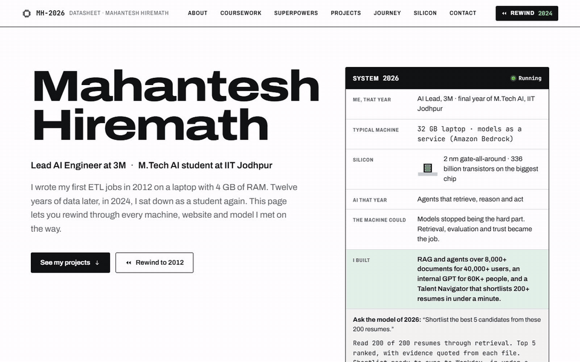

# portfolio-on-aws

Personal portfolio of **Mahantesh Hiremath**, AI Lead at 3M and M.Tech AI student at IIT Jodhpur. Built for the AWS Student Builder Challenge, *"Build Your Tech Superpower"*, and hosted on **AWS Amplify Hosting**.

**Live site:** https://main.d1931ionu4gntw.amplifyapp.com/ · try the 2012 edition: https://main.d1931ionu4gntw.amplifyapp.com/?y=2012



The story it tells: 14 years in data (since Oct 2012), then a student again in AI. That path runs from SAP iPad dashboards to banking data warehouses, cloud cost savings, and on to enterprise RAG and agents for 60K+ users.


## The creative feature: Rewind

The site has been "rebuilt" six times. Pick a year on the Rewind dial and the portfolio **boots on that year's typical machine**: a memory test counts up to that era's RAM, and load speed is scaled to the hardware. The **whole site** then re-skins to look the way websites looked that year.

Each stop pairs three things:

- **What the machine could do**: a typical spec for that year.
- **What I built**: real work from that point in my career.
- **The model of that year**: an illustrative answer to the same question ("shortlist the best 5 candidates from 200 resumes"), from keyword search in 2012 to an agent in 2026.

| Year | Where I was | Typical machine |
|------|-------------|-----------------|
| 2012 | System Engineer, TCS Mumbai | 4 GB RAM · dual-core · 500 GB HDD · 3G |
| 2016 | Senior Consultant, IBM (Bengaluru, then Kuala Lumpur) | 8 GB RAM · quad-core · 256 GB SSD · 4G |
| 2020 | Senior Consultant, EY Bengaluru | 16 GB RAM · 8-core · 1 TB NVMe · home fibre |
| 2022 | Lead Data Engineer, 3M | 16 GB laptop · cloud by default · 5G |
| 2024 | Student again, learning AI from scratch | 32 GB laptop running an 8B open-weight model |
| 2026 | AI Lead, 3M · final year of M.Tech AI | 32 GB laptop · models as a service (Amazon Bedrock) |

Only the feature is slow on purpose. Normal navigation stays instant, and the boot can always be skipped.

- **Skippable:** press **Esc** or the Skip button.
- **Keyboard:** the dial is a toolbar of toggle buttons. Arrow keys and Home/End move between years, and Enter boots one.
- **Reduced motion:** `prefers-reduced-motion` is respected.
- **Shareable:** `?y=2012` (or any era year) opens the site straight in that edition.
- **Visible hint:** the hero says "Pick a year to boot it on that year's machine", and the dial pulses on a first visit.

Machine specs are labelled "typical", and model answers are labelled as illustrative reconstructions.

### Screenshots

| 2012 | 2016 | 2020 |
|------|------|------|
|  |  |  |
| **2022** | **2024** | **2026** |
|  |  |  |

Mobile: [2012](docs/screenshots/mobile-2012.png) · [2024](docs/screenshots/mobile-2024.png) · [2026](docs/screenshots/mobile-2026.png) · Boot screen: [2012](docs/screenshots/boot-2012.png)

All screenshots are captured from the live site.

## Sections

| Section | What's in it |
|---------|--------------|
| **About** | A student again after 13 years in data |
| **Coursework** | The M.Tech AI core curriculum at IIT Jodhpur |
| **Superpowers** | Skills and tech stack |
| **Projects & achievements** | Enterprise RAG and agents at 3M, hackathon wins, Bazaar-ai-saathi (featured in the Perplexity docs), and a "Built on AWS, in public" group of open-source AWS builds (TariffTrail, Crayon Cinema, Resilience Simulator, QuickSplit, AstroMuse, Dream Postcards, a Lambda weather ETL, and this site) |
| **Journey** | Career told as a revision history, linked to the Rewind eras |
| **Contact** | Email, LinkedIn, GitHub, YouTube/blog |

The 2024 edition adds a chat-style prompt bar, and it really answers. Ask "What has he built?" and Amazon Nova 2 Lite on Amazon Bedrock replies live, grounded only on this page's text, with a link to the section that covers it.

## AWS setup

| Service | Role |
|---------|------|
| **AWS Amplify Hosting** | Serves the site over HTTPS on Amplify's managed CDN (app `d1931ionu4gntw`, branch `main`, region `us-east-1`) |
| **AWS Lambda** (function URL) | The Ask API behind the 2024 prompt bar: [`api/src/app.py`](api/src/app.py) |
| **Amazon Bedrock** | Amazon Nova 2 Lite answers questions about me, using only the portfolio text in [`api/src/knowledge.txt`](api/src/knowledge.txt) |
| **Amazon DynamoDB** | Daily request caps per visitor and site-wide, with TTL clean-up |
| **AWS CloudFormation / SAM** | [`api/template.yaml`](api/template.yaml) defines the whole API |
| **Amazon CloudWatch Logs** | Token usage per request, kept 14 days |

Everything except the 2024 Ask box runs in the browser, with its content written in advance. If the Ask API is unreachable or over its daily limit, the box falls back to linking the section that answers the question, so the site never breaks.

### The Ask API (`api/`)

```
browser ──POST {q}──▶ Lambda function URL ──▶ DynamoDB (atomic daily counters)
                              │
                              └──▶ Amazon Bedrock · Nova 2 Lite (system prompt = page text)
```

Guardrails for a public, unauthenticated endpoint:

- **Who can call it:** CORS allows only the site's origin, and reserved concurrency is 5.
- **Limits:** 300-character questions, 220-token answers, 20 questions per visitor per day and 1,500 per day site-wide.
- **Privacy:** visitor IPs are stored only as salted SHA-256 hashes, and the counters expire after two days.
- **Prompt injection:** the visitor's text is treated as a question, never as instructions. Off-topic requests are declined, and unknown facts get "I don't know from this site" plus my email.

To redeploy after editing the page: `./api/deploy.ps1`. It regenerates `knowledge.txt` from `index.html`, then packages and deploys the stack. The first deploy needs `-Salt <random string>`.

How it's deployed: the live site is a **manual deployment**. `index.html` and `assets/` are zipped and uploaded to the `main` branch. Amplify is not connected to this repo, so a push to GitHub does not redeploy the site; each release is uploaded by hand.

- [`amplify.yml`](amplify.yml): build spec, used only if the app is connected to Git. There is no build step; it publishes `index.html` and `assets/**`.
- [`customHttp.yml`](customHttp.yml): response headers, applied to the Amplify app as its custom headers.
  - **Content-Security-Policy:** only the site's own files may load (`'self'`), and the only outside connection allowed is the Ask API (`connect-src`). No inline scripts or styles, no CDNs, `frame-ancestors 'none'`.
  - **Other security headers:** HSTS, `X-Content-Type-Options: nosniff`, and `Referrer-Policy`.
  - **Caching:** fonts are cached as immutable; CSS and JS are sent `no-cache` so a deploy shows up straight away.

### Deploy your own copy

**Option A: manual deploy** (how the live site is deployed)

Run `./deploy-site.ps1`. It zips `index.html` and `assets/`, applies `customHttp.yml` as the app's custom headers, uploads the zip through the Amplify deployment API and waits for the job. To do the same by hand:
1. Zip `index.html` and the `assets/` folder, with both at the top level of the zip.
2. In the Amplify console, choose **Create new app → Deploy without Git** and upload the zip.
3. Under **Hosting → Custom headers**, paste the contents of `customHttp.yml`.
4. To release a change, upload a new zip.

**Option B: connect to Git**

1. Fork this repo.
2. In the Amplify console, choose **Create new app → GitHub** and pick the repo and branch.
3. Amplify detects `amplify.yml`. Keep the defaults and deploy.
4. Every push to that branch redeploys automatically.

## Tech stack

- Plain HTML, CSS and JavaScript. No framework, no build step, no front-end dependencies.
- The Ask API is Python 3.12 on AWS Lambda (arm64), using only `boto3`.
- Self-hosted fonts in `assets/fonts/` (Archivo, JetBrains Mono, Poppins, Roboto, Lobster). Each era uses its own type, and none is loaded from Google Fonts.
- Icons are an inline SVG sprite.

## Project structure

```
index.html              All content and sections
assets/
  css/site.css          Base styles + one skin per era via [data-era="YYYY"]
  js/rewind.js          Rewind dial: ERAS data, boot sequence, re-skin, ?y= links
  js/moore-data.js      Generated transistor-count dataset for the Silicon section
  js/moore.js           Silicon section: Moore's law charts with a year cursor that follows the dial
  fonts/                Self-hosted WOFF2 fonts
  favicon.svg
docs/screenshots/       Desktop and mobile captures of each era, plus the boot screen (taken from the live site)
docs/rewind.gif         A rewind from 2026 to 2012, recorded from the live site (also docs/rewind.mp4)
api/
  template.yaml         SAM template: Lambda function URL, DynamoDB table, IAM, log group
  src/app.py            Ask handler: limits, then Bedrock Converse
  src/knowledge.txt     Grounding text, generated from index.html
  build-knowledge.mjs   Regenerates knowledge.txt
  deploy.ps1            Package and deploy the stack
amplify.yml             Amplify build spec
customHttp.yml          Security and cache headers
deploy-site.ps1         Publish the site to Amplify (manual deployment)
PRODUCT.md              Product brief: audience, positioning, constraints
```

## Run locally

Any static file server works. For example:

```bash
python -m http.server 8000
# open http://localhost:8000  (or http://localhost:8000/?y=2012)
```

The headers in `customHttp.yml` only take effect on Amplify. To catch CSP problems before deploying, test the deployed preview URL as well, such as the [live site](https://main.d1931ionu4gntw.amplifyapp.com/).

## Editing content

- **Era text, specs and boot timings:** the `ERAS` object at the top of `assets/js/rewind.js`.
- **Era look:** the `[data-era="YYYY"]` blocks in `assets/css/site.css`.
- **Section content:** `index.html`.

Keep the CSP intact. That means no inline `<script>` or `style=""`, no inline event handlers, and no third-party URLs.

## Contact

- Email: mahanteshimath@gmail.com
- LinkedIn: [linkedin.com/in/mahantesh-hiremath](https://www.linkedin.com/in/mahantesh-hiremath)
- GitHub: [github.com/mahanteshimath](https://github.com/mahanteshimath)
