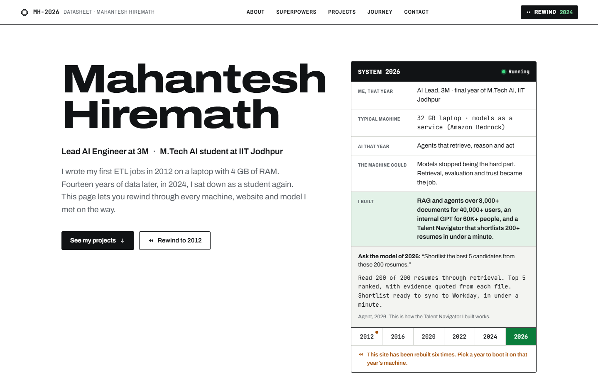
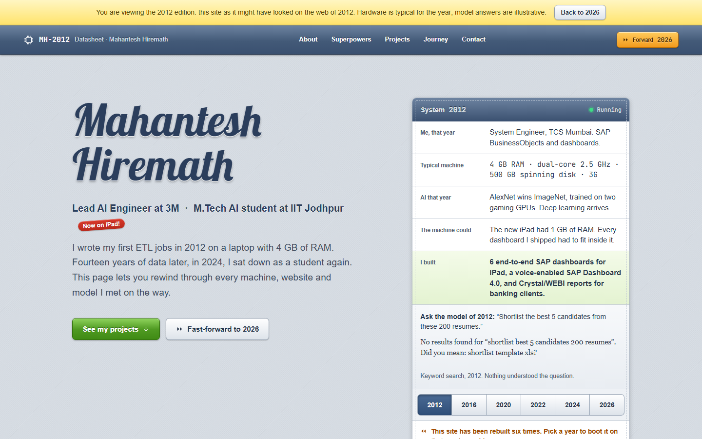
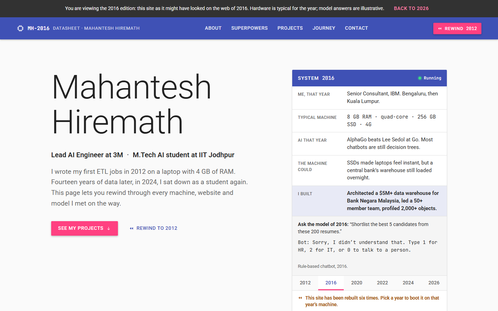
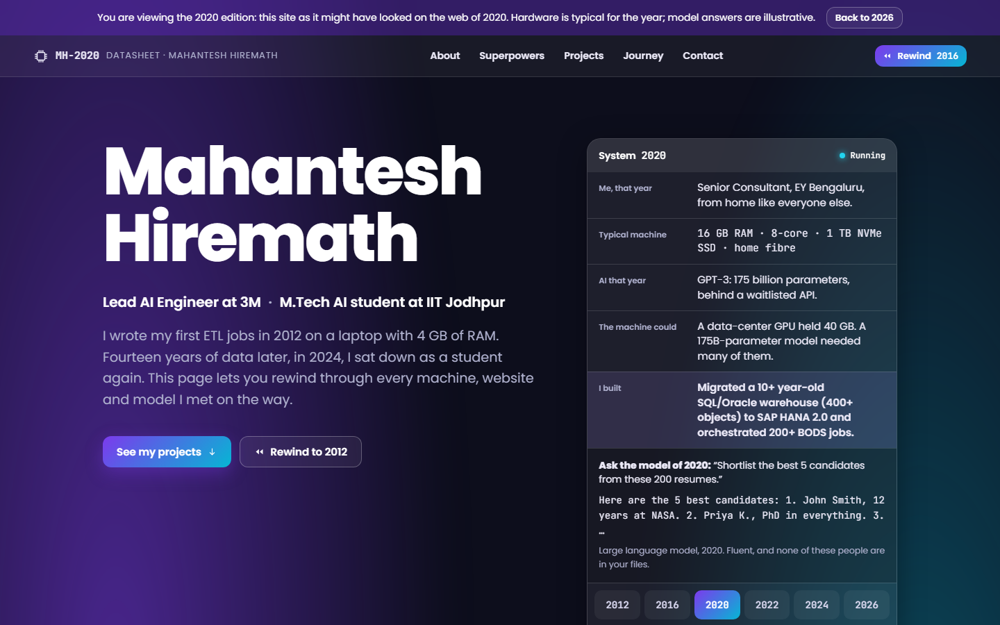
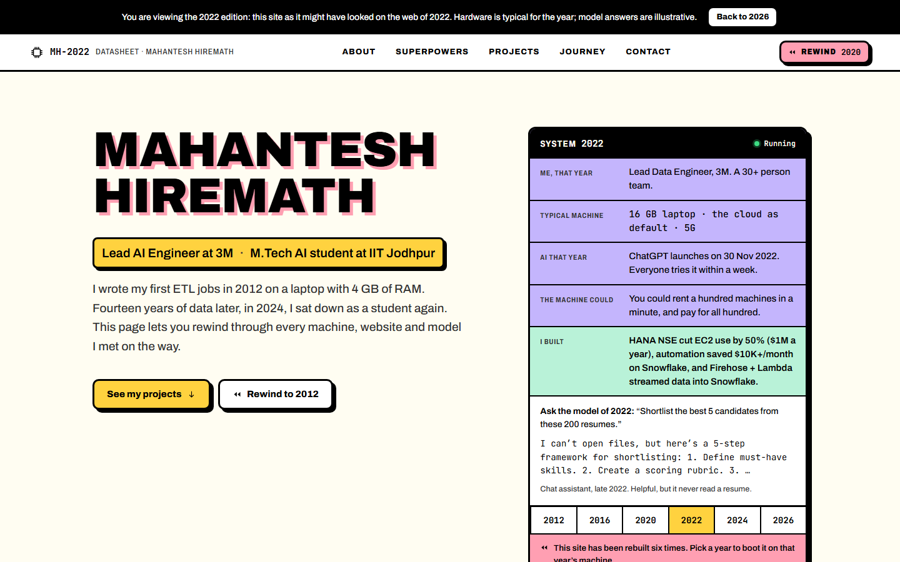
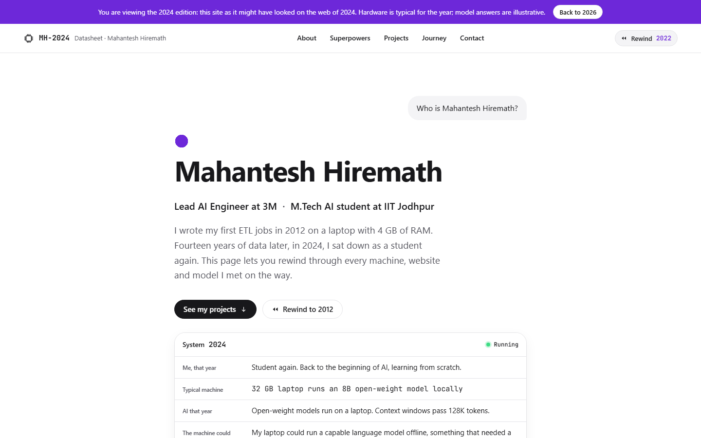

# portfolio-on-aws

Personal portfolio of **Mahantesh Hiremath**, AI Lead at 3M and M.Tech AI student at IIT Jodhpur. Built for the AWS Student Builder Challenge, *"Build Your Tech Superpower"*, and hosted on **AWS Amplify Hosting**.

The story it tells: 14 years in data (since Oct 2012), then a student again in AI. That path runs from SAP iPad dashboards to banking data warehouses, cloud cost savings, and on to enterprise RAG and agents for 60K+ users.



## The creative feature: Rewind

The site has been "rebuilt" six times. Pick a year on the Rewind dial and the portfolio **boots on that year's typical machine**: a memory test counts up to that era's RAM, and load speed is scaled to the hardware. The **whole site** then re-skins to look the way websites looked that year.

Each stop pairs three things:

- **What the machine could do**: a typical spec for that year.
- **What I built**: real work from that point in my career.
- **The model of that year**: an illustrative answer to the same question ("shortlist the best 5 candidates from 200 resumes"), from keyword search in 2012 to an agent in 2026.

| Year | Where I was | Typical machine |
|------|-------------|-----------------|
| 2012 | System Engineer, TCS Mumbai | 4 GB RAM · dual-core · 500 GB HDD · 3G |
| 2016 | Senior Consultant, IBM (Bengaluru, then Kuala Lumpur) | 8 GB RAM · quad-core · 256 GB SSD · 4G |
| 2020 | Senior Consultant, EY Bengaluru | 16 GB RAM · 8-core · 1 TB NVMe · home fibre |
| 2022 | Lead Data Engineer, 3M | 16 GB laptop · cloud by default · 5G |
| 2024 | Student again, learning AI from scratch | 32 GB laptop running an 8B open-weight model |
| 2026 | AI Lead, 3M · final year of M.Tech AI | 32 GB laptop · models as a service (Amazon Bedrock) |

Only the feature is slow on purpose. Normal navigation stays instant, and the boot can always be skipped.

- **Skippable:** press **Esc** or the Skip button.
- **Keyboard:** the dial is a radio group, so arrow keys and Home/End move between years.
- **Reduced motion:** `prefers-reduced-motion` is respected.
- **Shareable:** `?y=2012` (or any era year) opens the site straight in that edition.
- **Visible hint:** the hero says "Pick a year to boot it on that year's machine", and the dial pulses on a first visit.

Machine specs are labelled "typical", and model answers are labelled as illustrative reconstructions.

### Screenshots

| 2012 | 2016 | 2020 |
|------|------|------|
|  |  |  |
| **2022** | **2024** | **2026** |
|  |  |  |

Mobile: [2012](docs/screenshots/mobile-2012.png) · [2024](docs/screenshots/mobile-2024.png) · [2026](docs/screenshots/mobile-2026.png)

## Sections

| Section | What's in it |
|---------|--------------|
| **About** | A student again after 13 years in data |
| **Coursework** | The M.Tech AI core curriculum at IIT Jodhpur |
| **Superpowers** | Skills and tech stack |
| **Projects & achievements** | Enterprise RAG and agents at 3M, hackathon wins, Bazaar-ai-saathi (featured in the Perplexity docs), and this site |
| **Journey** | Career told as a revision history, linked to the Rewind eras |
| **Contact** | Email, LinkedIn, GitHub, YouTube/blog |

The 2024 edition adds a chat-style prompt bar. It sends a typed question ("What has he built?") to the section that answers it.

## AWS setup

| Service | Role |
|---------|------|
| **AWS Amplify Hosting** | Builds from this GitHub repo on every push, then serves the site over HTTPS on Amplify's managed CDN |

The creative feature runs entirely in the browser, with all its content written in advance. The site has no backend, makes no API calls and has no runtime network dependencies, so nothing can break during judging.

- [`amplify.yml`](amplify.yml): build spec. There is no build step; it publishes `index.html` and `assets/**`.
- [`customHttp.yml`](customHttp.yml): response headers.
  - **Content-Security-Policy:** only the site's own files may load (`'self'`). No inline scripts or styles, no CDNs, `frame-ancestors 'none'`.
  - **Other security headers:** HSTS, `X-Content-Type-Options: nosniff`, and `Referrer-Policy`.
  - **Caching:** fonts are cached as immutable; CSS and JS are sent `no-cache` so a deploy shows up straight away.

### Deploy your own copy

1. Fork this repo.
2. In the Amplify console, choose **Create new app → GitHub** and pick the repo and branch.
3. Amplify detects `amplify.yml`. Keep the defaults and deploy.
4. Every push to the branch redeploys.

## Tech stack

- Plain HTML, CSS and JavaScript. No framework, no build step, no dependencies.
- Self-hosted fonts in `assets/fonts/` (Archivo, JetBrains Mono, Poppins, Roboto, Lobster). Each era uses its own type, and none is loaded from Google Fonts.
- Icons are an inline SVG sprite.

## Project structure

```
index.html              All content and sections
assets/
  css/site.css          Base styles + one skin per era via [data-era="YYYY"]
  js/rewind.js          Rewind dial: ERAS data, boot sequence, re-skin, ?y= links
  js/moore-data.js      Generated transistor-count dataset (not loaded by the page yet)
  fonts/                Self-hosted WOFF2 fonts
  favicon.svg
docs/screenshots/       Desktop and mobile captures of each era
amplify.yml             Amplify build spec
customHttp.yml          Security and cache headers
PRODUCT.md              Product brief: audience, positioning, constraints
```

## Run locally

Any static file server works. For example:

```bash
python -m http.server 8000
# open http://localhost:8000  (or http://localhost:8000/?y=2012)
```

The headers in `customHttp.yml` only take effect on Amplify. To catch CSP problems before deploying, test the deployed preview URL as well.

## Editing content

- **Era text, specs and boot timings:** the `ERAS` object at the top of `assets/js/rewind.js`.
- **Era look:** the `[data-era="YYYY"]` blocks in `assets/css/site.css`.
- **Section content:** `index.html`.

Keep the CSP intact. That means no inline `<script>` or `style=""`, no inline event handlers, and no third-party URLs.

## Contact

- Email: mahanteshimath@gmail.com
- LinkedIn: [linkedin.com/in/mahantesh-hiremath](https://www.linkedin.com/in/mahantesh-hiremath)
- GitHub: [github.com/mahanteshimath](https://github.com/mahanteshimath)
